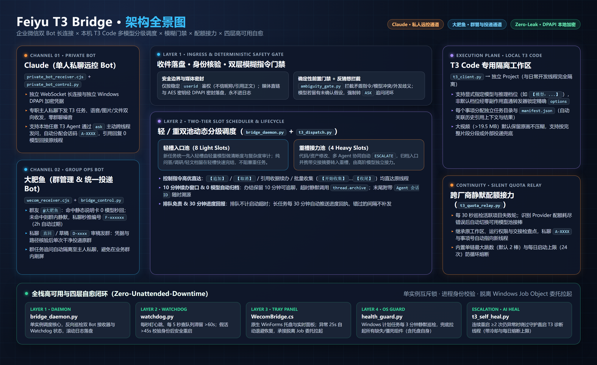
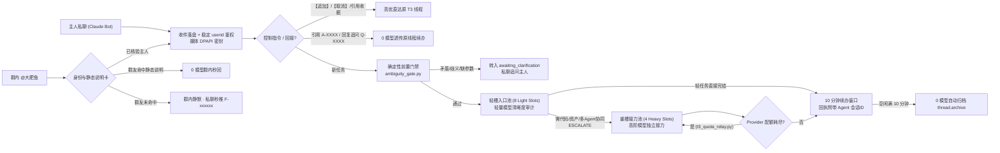
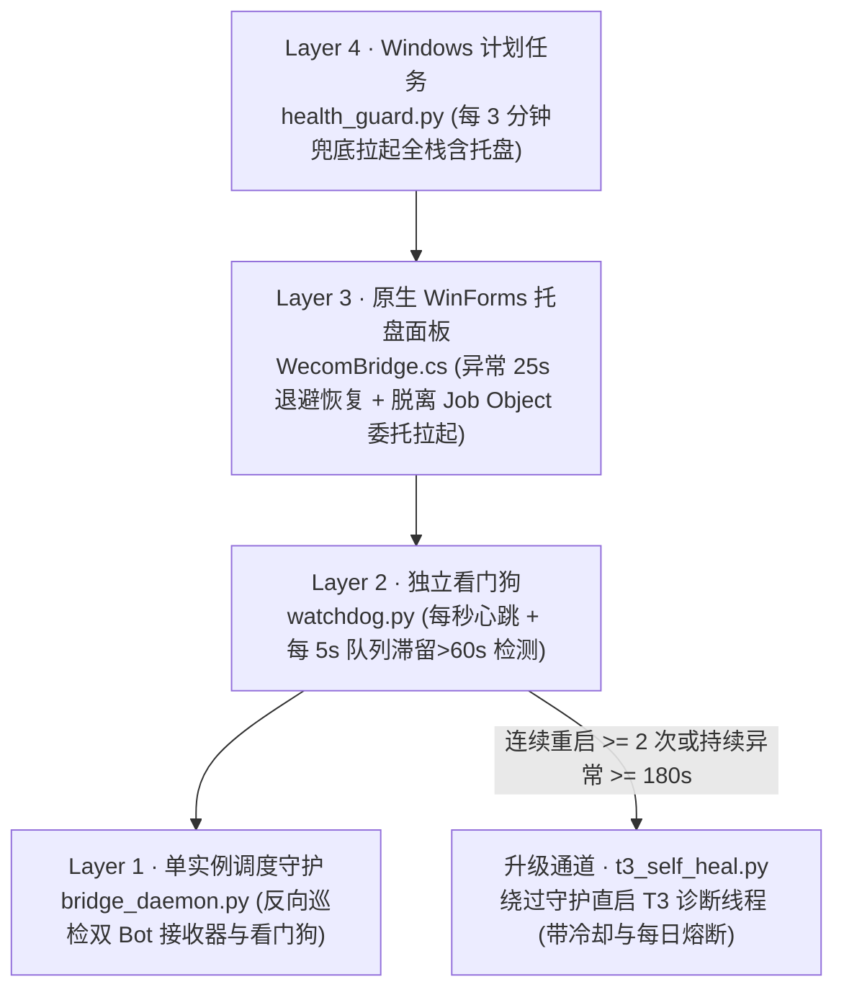

<p align="center">
  
</p>

<h1 align="center">Feiyu T3 Bridge（肥鱼桥）</h1>

<p align="center">
  <strong>基于企业微信官方长连接 SDK 的双 Bot × 本机 T3 Code 多模型分级调度、配额接力与四层高可用自愈桥接系统</strong>
</p>

<p align="center">
  <em>Dual-Bot WeCom ↔ Local T3 Code Orchestration, Ambiguity Gate, Silent Quota Relay &amp; 4-Layer Self-Healing Bridge for Windows</em>
</p>

<p align="center">
  
  
  
  
  
  
</p>

---

## 为什么做肥鱼桥？

日常用 [T3 Code](https://github.com/pingdotgg/t3code) 驱动多模型 Coding Agent（Gemini / GPT / Claude）时，离开电脑或人在手机企微群里沟通业务，往往会遇到几个痛点：

- **想随时手机远控本机 Agent 干活**，又不想把个人私聊指令和群友 `@` 提问混在同一个窗口里刷屏；
- **轻任务和重任务混跑容易互相堵死**，且模糊/矛盾指令如果直接放进 Agent 执行，很容易按错误猜想白跑半小时；
- **本机后台某条长任务卡住或需要主人拍板**，Agent 没法主动发消息到你手机上问一句、再等你一句话回复后接着原线程往下干；
- **跑着跑着某个 Provider 的 5h/周配额耗尽了**，人不在电脑旁任务就干晾在那里；
- **Windows 上常驻守护进程极易被命令行 Job Object 误杀或假活断连**，需要真正无人值守的自愈闭环。

**肥鱼桥（Feiyu T3 Bridge）** 就是为了解决这一整套工程闭环搭出来的本机桥接系统：纯本机运行、无需公网回调服务器、凭据走 Windows DPAPI 加密，直接通过企业微信官方 WebSocket 长连接驱动本机 T3 Code。

---

## 架构全景图

<p align="center">
  
</p>

---

## 双 Bot 分工设计

| Bot 角色 | 实现模块 | 定位与职责 |
| :--- | :--- | :--- |
| **Claude（单人私聊远控 Bot）** | `bridge/private_bot_receiver.cjs`<br>`bridge/private_bot_control.py`<br>`bridge/agent_relay.py` | 专职主人自用单人私聊与 T3 远控：独立长连接、独立 DPAPI 凭据、零群推送噪音；支持语音/图片/文件双向收发，以及本地任意 T3 Agent 主动经 `ask` 发问并按 `A-XXXX` 回接原线程。 |
| **大肥鱼（群管理 & 统一投递 Bot）** | `bridge/wecom_receiver.cjs`<br>`bridge/bridge_control.py`<br>`bridge/group_relay.py` | 专职群消息管理与对外投递：群友 `@` 命中静态说明卡 0 模型秒回，未命中则**群内静默**并私聊秒推主人（编号 `F-xxxxxx`）；支持 `直回`、草稿 `D-xxxx` 审稿发群、以及群任务追问自动隔离至主人私聊。 |

---

## 核心链路流程图（Mermaid）

### 1. 消息入站 → 门禁审计 → 轻/重双池调度 → 配额接力



### 2. 四层高可用自愈与 T3 自动诊断升级



---

## 常用交互指令速查

| 场景 | 指令 / 操作方式 | 行为说明 |
| :--- | :--- | :--- |
| **指定模型直达** | `【模型：gpt-6.2-astra max】...` / `用 neon 处理...` | 默认档位直接启动；非默认推理档位经精确直通转发器锁定 `options`，不静默降级 |
| **批量收集多条消息** | `【开始收集】` → 连发图文语音 → `【收尾】` | 合并为一个完整任务包（300 秒超时保护，支持收尾时同时指定模型） |
| **运行中追加 / 取消** | `【追加】<7位码> <内容>` / `【取消】<7位码>`<br>或直接**引用收据消息**回复 | 排队、运行中及办结 10 分钟窗口内均直达原线程；已归档旧收据被引用时自动携带历史上下文开新任务 |
| **回报路径控制** | `【回报：原路】` `【回报：本人私聊】` `【回报：仅面板】` `【回报：静默】` | 可与 `【模型：...】` 任意顺序组合 |
| **追问确认** | 引用追问消息回复，或 `【答复 Q-XXXX】内容` | 仅有 1 个待确认事项时支持简短回复 `A` / `1` / `选A` |
| **本地 Agent 主动问主人** | `python bridge/private_bot_control.py ask --thread-id <ID> --text-file msg.txt` | 自动分配 `A-XXXX` 发至私聊；主人引用回复后 0 模型直回原 T3 线程 |
| **群友 `@` 秒推处置** | `【直回 F-xxxxxx】正文` / `【忽略 F-xxxxxx】` | 0 模型极速发群或关闭；超过 2 小时未处理静默自动忽略 |
| **Agent 查证 + 审稿发群** | 提问末尾加 `发到某某群` / `发到 F-xxxxxx` | 先回私聊呈交干净草稿 `D-xxxx`，回复 `发` / `【改发 D-xxxx】` / `不发` 决定投递 |
| **静态说明卡（0 模型）** | 群内 `@大肥鱼 【发布说明】标题\n正文` / `【说明】` | 常见问题自助查询，不消耗任何模型额度 |

---

## 仓库目录结构

```text
feiyu-t3-bridge/
├── README.md                         # 本说明页
├── docs/
│   ├── assets/
│   │   ├── banner.jpg                # 双 Bot 看板娘横幅
│   │   └── architecture.png          # 架构全景信息图
│   ├── ARCHITECTURE.md               # 完整架构、状态机与协议细节
│   ├── REPRODUCE_WITH_AI.md          # 专给 AI Agent / 开发者本机 1:1 复现的操作指南
│   └── WATCHDOG_ACCEPTANCE.md        # 守护进程机制与自愈验收规范
├── bridge/                           # 51 个现役核心源码（Python / Node CJS / C# WinForms）
├── config/                           # 脱敏配置模板（*.example.json）
├── tests/                            # 现役核心单元测试（Python unittest + Node CJS）
└── scripts/
    ├── sanitize_audit.py             # 零泄露自动化审计门禁（推送前必跑）
    └── sync_from_live.py             # 本地运行目录 → 本仓库单向脱敏同步脚本
```

---

## 快速复现与给 AI 的入口

如果你希望让自己的 Coding Agent（或自己动手）在 Windows 本机从零复现这套双 Bot 桥接：

1. 直接把 **[docs/REPRODUCE_WITH_AI.md](docs/REPRODUCE_WITH_AI.md)** 交给你的 AI Agent，里面列齐了：
   - 依赖安装（Python 3.11+ / Node.js 20+ / `@wecom/aibot-node-sdk@1.0.6` / T3 Code CLI）；
   - 复制 `config/*.example.json` 并填入自己的企业微信 Bot 凭据（经 Windows DPAPI 加密，不落明文）、稳定 `owner_ws_userids` 和隔离用 T3 Project ID；
   - 环境变量表、托盘程序编译命令（`csc.exe` 编译 `bridge/WecomBridge.cs`）与 Windows 计划任务注册方式；
   - 离线单元测试与端到端自检验收命令。
2. 深入设计细节与全量状态机见 **[docs/ARCHITECTURE.md](docs/ARCHITECTURE.md)**。

### 本地运行单元测试

```powershell
# 运行 Python 核心单测
python -m unittest discover -s tests -p "test_*.py"

# 运行零泄露安全门禁检查
python scripts/sanitize_audit.py
```

---

## 安全与隐私声明

- 本仓库为**彻底脱敏的开源版本**：不包含任何真实企业微信密钥、DPAPI 文件、数据库、聊天记录、真实群 `chatid`、个人路径或内部项目名称。
- 所有本地运行态数据与凭据均已列入 `.gitignore`，并内置 `scripts/sanitize_audit.py` 作为推送前强门禁。

## License

[MIT](LICENSE)
